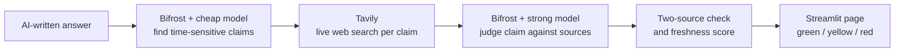
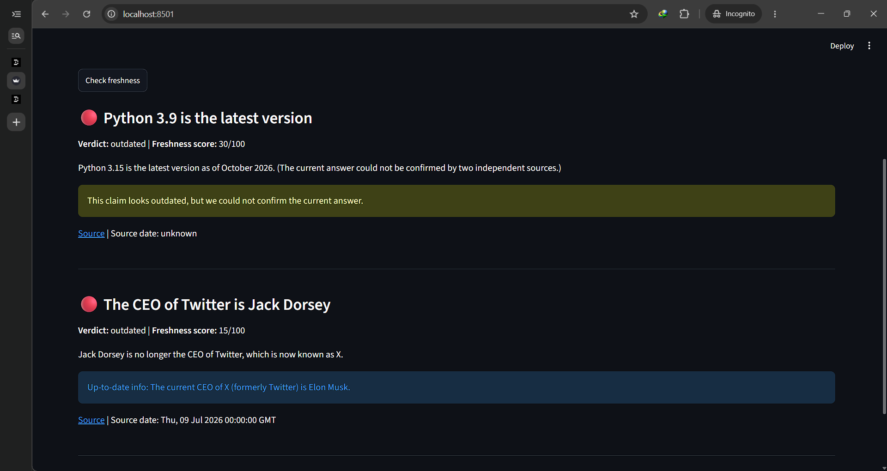
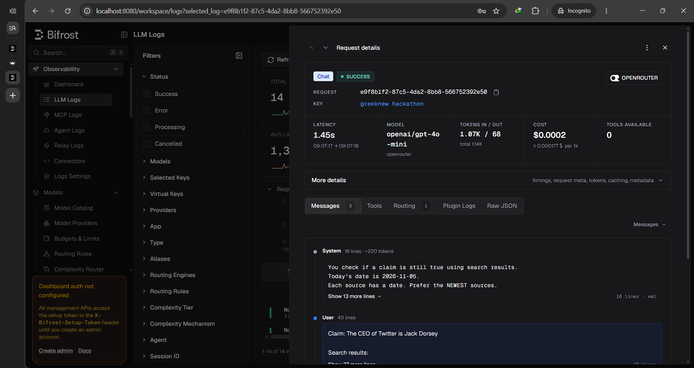
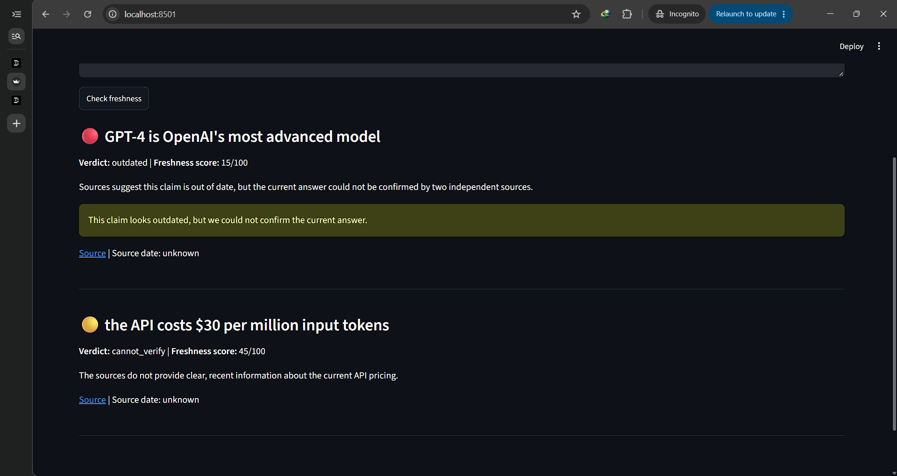
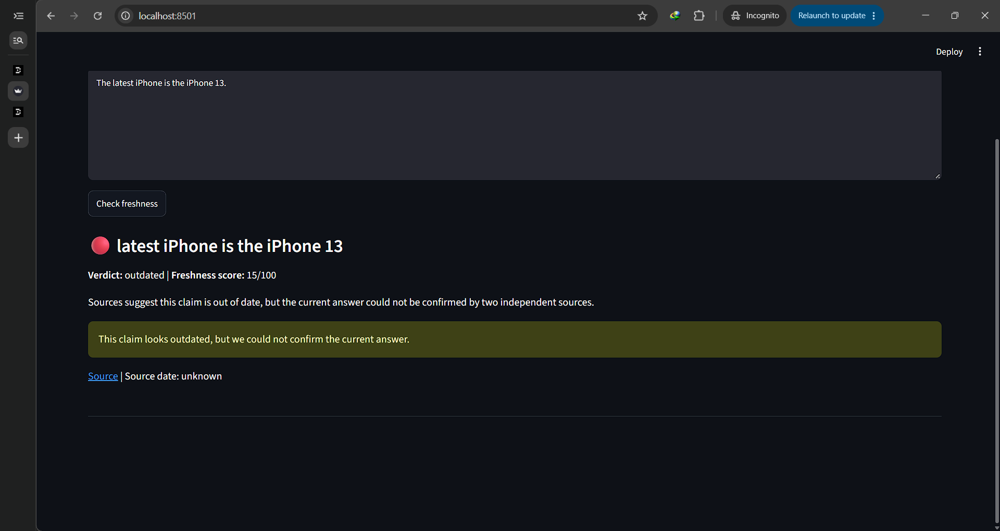
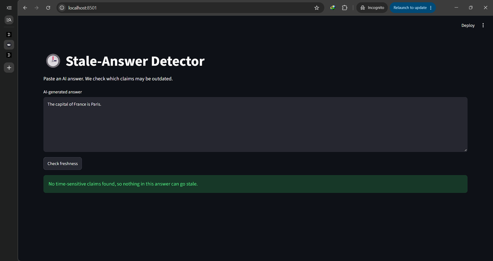

# Stale-Answer Detector

Paste an AI-written answer. The tool finds the claims that can go out of date (prices, versions, laws, leaders, "latest" statements), checks them against live web sources, and gives each claim a freshness score.

Built for the **Geek Room Global AI Hackathon 2026**, Problem Statement 06: *Build a Stale-Answer Detector for AI Applications*. It uses both **Tavily** (live web search) and **Bifrost by Maxim AI** (model gateway).

Built by Vaibhavi Kashyap (GitHub: [whybhvi-stack](https://github.com/whybhvi-stack)).

## The problem

AI models can state old information as if it were current. Prices change, software gets new versions, laws are updated and company leaders change, but the AI answer still sounds confident. Users have no quick way to see which parts of an answer may be out of date.

## What it does

1. **Extract:** a cheap model reads the answer and picks out the time-sensitive claims.
2. **Search:** Tavily searches the live web for each claim (last 12 months, news sources for leadership and statistics claims).
3. **Judge:** a stronger model compares the claim with the search results and decides: `still_true`, `outdated` or `cannot_verify`.
4. **Check:** a corrected fact is shown only if two different websites support it. Otherwise the app says the current answer could not be confirmed, instead of guessing.
5. **Score:** each claim gets a freshness score from 0 to 100 and a colour (green, yellow, red).

## Architecture



## How Tavily is used

- Every flagged claim gets its own live web search through the Tavily API.
- Searches are limited to the last year, and leadership and statistics claims use Tavily's news topic.
- The title, link, date (when available) and text of each result go to the judging model, and the best link is shown to the user so they can verify it.

## How Bifrost is used

- **One gateway for every model call.** The app talks only to Bifrost's OpenAI-compatible endpoint. Provider API keys live in Bifrost, not in the app code.
- **Virtual key.** The app sends a Bifrost virtual key, which controls which providers it may use.
- **Two models, two jobs.** A cheap model extracts claims and a stronger model judges them. Both are set in `.env`, so you can change a model without changing code.
- **Logs.** The Bifrost dashboard shows every request with its model, tokens and latency (see the screenshot below).

## Freshness score

| Part | Points |
|---|---|
| Verdict `still_true` | 75 |
| Verdict `cannot_verify` | 40 |
| Verdict `outdated` | 10 |
| Source from a trusted site (docs, .gov, Wikipedia, major news, etc.) | +20 |
| Other source | +5 |
| Test or staging website | -15 |

The score is limited to 0-100. Green is 70 or more, yellow is 40 to 69, red is below 40.

## Screenshots

**Running the app**



**Bifrost logs**



**After our fixes**



**After our fixes: iPhone answer** (flagged as outdated, no wrong replacement shown)



**After our fixes: nothing to check** (no time-sensitive claims, so no false alarm)



## Test results

We tested 6 answers on 6 Nov 2026 and checked the real situation by hand.

- Stale answers flagged: **4 of 4**.
- False alarms: **0**.
- Wrong replacement facts: the first version showed 2, and we fixed this by hiding any correction that two sources do not confirm.

This is a small test, so it shows the idea works but is not a full benchmark. Full results, including what went wrong, are in [`tests/samples.md`](tests/samples.md).

## Installation

**You need:** Python 3.10 or newer, Node.js, a free [Tavily](https://tavily.com) API key, and an API key from at least one model provider.

**1. Clone and install**

```bash
git clone https://github.com/whybhvi-stack/stale-answer-detector.git
cd stale-answer-detector
python -m venv venv
venv\Scripts\activate          # macOS/Linux: source venv/bin/activate
pip install -r requirements.txt
```

**2. Start Bifrost** (in its own terminal, and leave it running)

```bash
npx -y @maximhq/bifrost
```

If Bifrost shows a setup-token screen on first start, stop it, set a secret of your choice, and start it again:

```powershell
$env:BIFROST_SETUP_TOKEN = "choose-a-secret"
npx -y @maximhq/bifrost
```

**3. Set up Bifrost** at http://localhost:8080

1. Go to **Models → Model Providers** and add your provider with its API key.
2. Go to **Virtual Keys**, create a key, allow your provider and its models, and copy the key.

**4. Add your keys**

Copy `.env.example` to `.env` (`copy .env.example .env` on Windows, `cp .env.example .env` on macOS/Linux) and fill it in:

```
TAVILY_API_KEY=your_tavily_key_here
BIFROST_BASE_URL=http://localhost:8080/v1
BIFROST_VIRTUAL_KEY=your_bifrost_virtual_key_here
CHEAP_MODEL=provider/model-name
STRONG_MODEL=provider/model-name
```

Model names use the form `provider/model-name`. Copy exact names from **Models → Model Catalog** in the Bifrost dashboard. Never upload your `.env` file.

**5. Check the connection**

```bash
python src/llm.py
```

A short greeting means Bifrost and your keys work.

**6. Run the app**

```bash
streamlit run app.py
```

Open http://localhost:8501, paste an AI answer and click **Check freshness**.

## Project structure

```
app.py              Streamlit web page
src/llm.py          Talks to Bifrost (all model calls go through here)
src/claims.py       Step 1: find time-sensitive claims (cheap model)
src/verify.py       Steps 2-4: Tavily search, judge, two-source check (strong model)
src/score.py        Step 5: freshness score and colour
src/pipeline.py     Connects the steps
src/test_models.py  Small test for the model connection
src/test_tavily.py  Small test for the Tavily connection
tests/samples.md    Test results
screenshots/        Screenshots used in this README
```

## Limitations and next steps

- Search results can be old or low quality. We filter a small list of weak sites, but this is not perfect.
- "Source date" often shows "unknown", because search results do not always include a date.
- The claim finder can skip a claim or drop the product name, which can make the search too vague.
- Only 6 answers were tested.

Next steps:

- Bifrost fallback to a second model when the first one fails (an optional setting exists in `src/llm.py`, but it is not tested yet).
- Bifrost caching, so repeated claims are not paid for twice.
- A bigger test set, a REST API and a browser extension.

## Technologies

Python, Streamlit, Tavily API, Bifrost by Maxim AI (model gateway), OpenAI Python SDK (used as the client for Bifrost), python-dotenv.